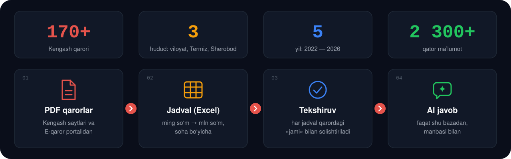

<p align="center">
  
</p>

<p align="center">
  
  
  
  
</p>

<p align="center">
  <b>Har bir so‘m hisobda.</b> Kengash qarorlari ochiq, lekin tushunarsiz.<br>
  «O‘z pulim» ularni fuqaro tiliga o‘giradi va har bir javobni manbasi bilan beradi.
</p>

## ✨ Imkoniyatlar

| Bo‘lim | Nima beradi |
|:--|:--|
| 📥 **Kirim** | budjetga qancha pul tushgani |
| 📤 **Chiqim** | maktab, yo‘l, shifoxonaga qancha sarflangani |
| ➕ **Qo‘shimcha ajratmalar** | ortib qolgan pul kimga va nimaga berilgani |
| 📄 **Manba** | qaror raqami, sanasi va E-qaror havolasi — har bir javobda |
| ✍️ **Kengashga savol** | savolni rasmiy murojaat matniga aylantiradi |
| 🔔 **Obuna** | yangi qaror chiqqanda barcha foydalanuvchilarga xabar |
| 🌐 **3 til** | o‘zbek, ingliz, rus |

## 🧠 Qanday ishlaydi

<p align="center">
  
</p>

Sun’iy intellekt (AI) internetdan emas, faqat Kengash qarorlaridan yig‘ilgan bazadan javob beradi: bazada yo‘q narsani aytmaydi, reja va haqiqiy sarfni aralashtirmaydi.

## 🚀 Ishga tushirish

Bot Google Colab’da — bulutli muhitda (cloud) ishlaydi:

1. Birinchi katakka (cell) kutubxonalarni (libraries) o‘rnating:
   ```python
   !pip install -q python-telegram-bot google-genai pandas openpyxl
   ```
2. Ikkinchi katakka [`O_z_pulim_bot.py`](O_z_pulim_bot.py) kodini qo‘ying va `BOT_TOKEN`, `GEMINI_API_KEY` ni yozing.
3. Katakni ishga tushiring: bot Excel fayllarni o‘zi topadi, topmasa — yuklashni so‘raydi.

> ⚠️ **Diqqat:** bot tokeni (token) va API kalitni (API key) GitHub’ga hech qachon yuklamang.

## ⚖️ Huquqiy asos

«O‘z pulim» yangi huquq yaratmaydi — mavjud huquqni amalda ishlatishni osonlashtiradi: O‘zbekiston Respublikasi Konstitutsiyasi, «Davlat hokimiyati va boshqaruvi organlari faoliyatining ochiqligi to‘g‘risida»gi (O‘RQ-369) va «Jamoatchilik nazorati to‘g‘risida»gi (O‘RQ-474) qonunlar.

---

<p align="center">
  <sub>Termiz davlat universiteti, yuridik fakultet talabalari · Ilmiy maslahatchi: Sayqalbek Allayorov<br>
  #LexHackathon2026 · #OchiqBudjet · Toshkent, 2026</sub>
</p>
